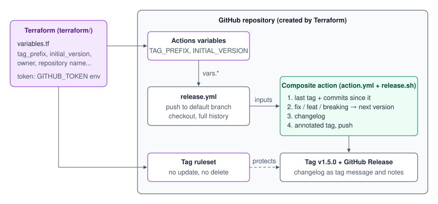

# conventional-release-action

[](https://github.com/johnvega-cloud/conventional-release-action/actions/workflows/ci.yml)
[](https://github.com/johnvega-cloud/conventional-release-action/actions/workflows/release.yml)

A GitHub Actions composite action that reads conventional commits, works out
the next semantic version, generates the changelog and pushes the Git tag.
The repository and its settings are created with Terraform.



## The problem

> Develop a reusable GitHub Actions composite action that performs semantic
> versioning, changelog generation, and automated Git tagging based on
> conventional commits.

## How it works

The action is [`action.yml`](action.yml) plus one Bash script,
[`release.sh`](release.sh). On each run the script:

1. Finds the last release tag reachable from `HEAD` (or uses `initial-version`).
2. Reads every commit since that tag and keeps the biggest change:

   | Commit | Bump | Example |
   |---|---|---|
   | `fix: ...` | patch | 1.4.2 → 1.4.3 |
   | `feat: ...` | minor | 1.4.2 → 1.5.0 |
   | `feat!: ...` or a `BREAKING CHANGE:` footer | major | 1.4.2 → 2.0.0 |
   | anything else (`docs`, `chore`, `ci`...) | none | no release |

3. Writes the changelog of the new version (Breaking changes, Features, Bug fixes).
4. Creates an annotated tag whose message is that changelog, and pushes it.

Running it again without new commits does nothing: the new tag is now the last
tag and there are no commits after it.

## Usage

```yaml
permissions:
  contents: write

steps:
  - uses: actions/checkout@v7
    with:
      fetch-depth: 0 # the action needs the full history and the tags

  - id: release
    uses: johnvega-cloud/conventional-release-action@v0.1.0
    with:
      tag-prefix: ${{ vars.TAG_PREFIX }}
      initial-version: ${{ vars.INITIAL_VERSION }}

  - if: steps.release.outputs.released == 'true'
    run: echo "Released ${{ steps.release.outputs.tag }}"
```

A complete example, which also publishes a GitHub Release, is this repository's
own workflow: [`.github/workflows/release.yml`](.github/workflows/release.yml).

| Input | Default | Meaning |
|---|---|---|
| `tag-prefix` | `v` | text before the version in the tag |
| `initial-version` | `0.0.0` | starting point when there is no release tag |
| `git-user-name` | `github-actions[bot]` | tagger name |
| `git-user-email` | the bot's noreply address | tagger email |

| Output | Example | Meaning |
|---|---|---|
| `released` | `true` | `false` when there was nothing to release |
| `version` | `1.5.0` | new version without the prefix |
| `tag` | `v1.5.0` | new tag |
| `changelog-file` | `/tmp/changelog-v1.5.0.md` | Markdown changelog of the new version |

## Terraform

[`terraform/`](terraform/) creates everything on the GitHub side, so nothing is
set by hand and no value is written twice:

| Resource | Why |
|---|---|
| `github_repository` | the repository itself |
| `github_actions_variable` (`TAG_PREFIX`, `INITIAL_VERSION`) | the workflow reads them as `vars.*` instead of having the values in the YAML |
| `github_repository_ruleset` | tags matching `<tag_prefix>*` cannot be moved or deleted |

Every value is a variable ([`terraform/variables.tf`](terraform/variables.tf));
the token comes from the `GITHUB_TOKEN` environment variable. The same
`tag_prefix` variable feeds the workflow and the ruleset, so they cannot drift.

Step by step commands: [docs/BUILD_GUIDE.md](docs/BUILD_GUIDE.md).

## Other platforms

This repository targets GitHub Actions because the problem asks for a composite
action. The logic itself is not tied to GitHub: [`release.sh`](release.sh) only
needs Bash, Git and two environment variables (`TAG_PREFIX`, `INITIAL_VERSION`),
so it runs unchanged on other CI systems. What has to be rewritten is the
wrapper around it and the Terraform code:

| | GitHub (this repository) | AWS | Azure |
|---|---|---|---|
| Runs the pipeline | GitHub Actions | CodeBuild / CodePipeline | Azure Pipelines |
| Reusable wrapper | composite action (`action.yml`) | shared `buildspec.yml` | YAML pipeline template |
| Terraform provider | `integrations/github` | `hashicorp/aws` | `microsoft/azuredevops` |
| Permission to push the tag | `contents: write` on the job token | IAM role of the build project | build service identity on the repository |

Those ports are not built or tested here. The more common setup is the one this
repository already fits: the code and the pipeline stay on GitHub, and a later
job deploys to AWS or Azure using the version this action produces (for example
as the image tag instead of the commit SHA).

## Tests

```bash
bats tests/
```

Each test builds a temporary Git repository with a local bare remote, so no
network or GitHub account is needed.

## Known limits

- A commit that is not a conventional commit is ignored, not rejected.
- A breaking change always bumps the major version, also below 1.0.0.
- The changelog is stored in the tag message and the GitHub Release, not in a
  `CHANGELOG.md` file: committing a file would need a push to the default branch.
- A tag pushed with the default `GITHUB_TOKEN` does not trigger other workflows.
- Terraform state is local.

## License

MIT
